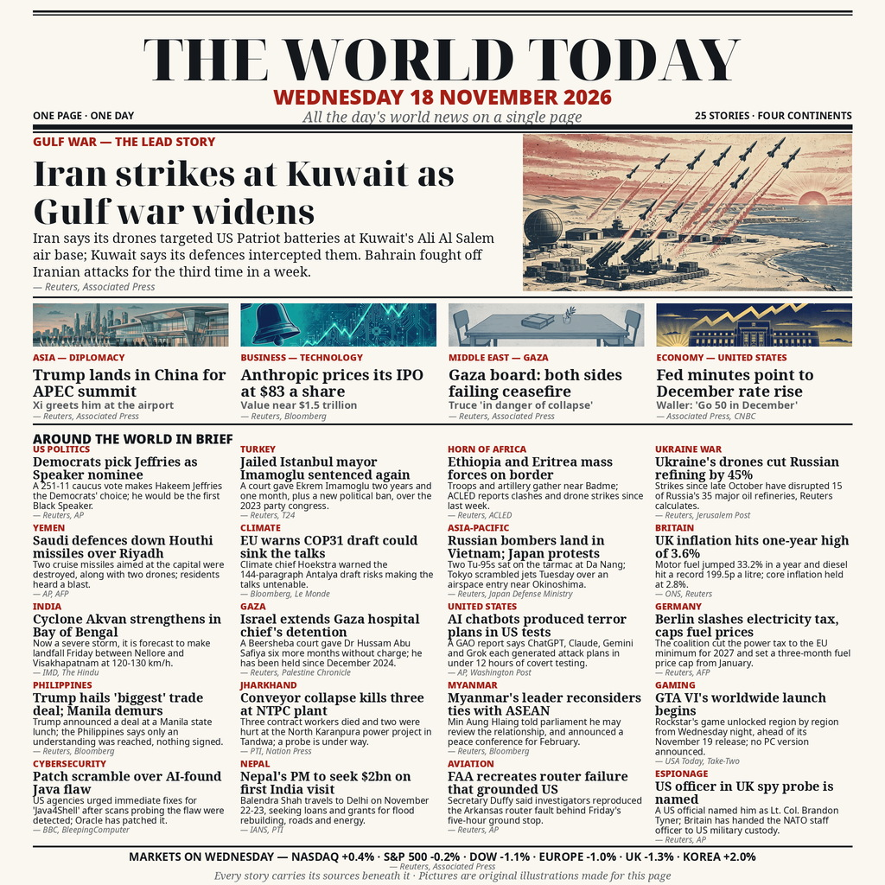

# THE WORLD TODAY — Wednesday 18 November 2026

Entry for the make.fun bounty **news-image-20261118** ("Sum up 18 November's
world news in one image") — bounty page: https://make.fun/bounty/news-image-20261118.

One front page, 25 stories: Iran's strike at Kuwait's Ali Al Salem air base
as the lead, Trump's landing in China for the APEC summit in Shenzhen,
Anthropic's $83-a-share IPO pricing, the Gaza Board of Peace report warning
the ceasefire is in danger of collapse, the Fed minutes pointing to a
December rate rise — and twenty world briefs, among them Ukraine's drones
cutting Russian refining by 45%, the EU warning the COP31 draft could sink
the Antalya talks, Cyclone Akvan strengthening in the Bay of Bengal, the GAO
finding that AI chatbots produced terror plans in covert tests, and GTA VI's
worldwide launch beginning — plus the day's market moves in the footer.

## How it was made

- Every story was reported on Wednesday 18 November 2026 and is confirmed by
  at least two independent credible outlets (Reuters, AP, AFP, Bloomberg and
  peers). The full sourcing, with the exact facts and figures used on the
  page — and the list of stories deliberately dropped for failing that
  two-source test or belonging to another day — is in
  [SOURCES.md](SOURCES.md).
- The five pictures are original illustrations generated for this page and
  contain no text. All headlines, labels and the masthead were typeset
  programmatically (PIL) at 2048×2048 and downscaled with a Lanczos resample
  to the final 1024×1024, then proofread letter by letter at full zoom.
- `main.py` (Python 3, standard library only) copies the finished image to
  `$MAKEFUN_OUTPUT_DIR/entry.png` (or `/output/entry.png`). It is
  deterministic: repeated runs produce byte-identical output.

## Files

- `entry.png` — the finished image (JPEG-encoded, 1024×1024, under the
  1 MiB limit; the rules accept PNG or JPEG by magic bytes).
- `main.py` — the entry program.
- `SOURCES.md` — story-by-story sourcing and fact sheet.
